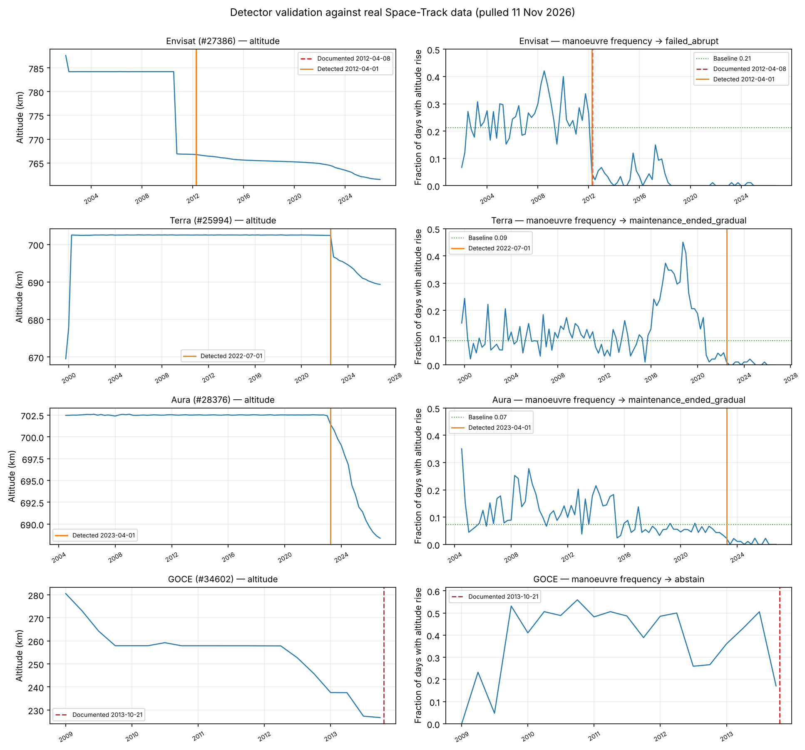

# Pricing Orbital Risk

**A data-driven model of satellite failure hazard in low Earth orbit**

Foundations of Data Science — course project
BITS Pilani Dubai Campus

---

## The problem

Satellite insurance prices risk as a flat 5–12% of asset value, with almost no adjustment for where a satellite actually orbits. Debris density in LEO varies by more than an order of magnitude between altitude bands and has shifted sharply over the past decade.

The consequence is a market that cannot measure the risk it underwrites. Fewer than 1% of active LEO satellites carry in-orbit insurance — roughly 300 out of 10,000 — and in 2023 insurers paid $995M in claims against $557M in premiums, a loss ratio near 180%.

**This project asks whether that risk can be measured from public data alone, and how far the market's flat rate sits from what the orbital environment implies.**

---

## Approach

### Failure labels are derived, not inherited

The central methodological choice. Public failure registries cover mostly large, insured, Western spacecraft, which would bias any model trained on them and leave too few events to fit anything.

Instead, failures are detected from orbital behaviour. An operational satellite fights atmospheric drag by periodically raising its orbit. When maintenance ends, the raising stops and the trace becomes monotonic decay. That transition applies uniformly to every object and yields far more events.

**Detection uses manoeuvre frequency, not magnitude.** This was established by validating against real data, and it corrected an assumption that was wrong by roughly a factor of twenty — see below.

Curated failure records serve as the **validation set** rather than the training target.

### Validation against real data

Pulled from Space-Track on 11 November 2026: 82,623 element sets across Envisat, Terra, Aura and GOCE. **4 of 4 classified correctly.**

| Satellite | Expected | Detected | Baseline | Decline | Error |
|---|---|---|---|---|---|
| Envisat | failure | `failed_abrupt` | 0.212 | 1 quarter | **−7 days** |
| Terra | not a failure | `maintenance_ended_gradual` | 0.089 | 8 quarters | — |
| Aura | not a failure | `maintenance_ended_gradual` | 0.072 | 6 quarters | — |
| GOCE | abstain | `abstain` (below altitude floor) | — | — | — |



**The premise holds.** Envisat lost contact on 8 April 2012, the first week of Q2. Its manoeuvre frequency collapses in exactly that quarter: 0.251 before, 0.018 after, with monotonic decay beginning immediately. The detector dates cessation to 1 April 2012 — the quarter boundary, and the finest resolution a quarterly series can give.

**But the original threshold was wrong by ~20×.** The first detector looked for orbit-raising burns above 0.3 km. Envisat's real burns move semi-major axis by about 0.016 km/day at the 99th percentile. That detector found *zero* manoeuvres across Envisat's entire operational life and would have discarded a documented failure as "never station-keeping." Frequency works where magnitude does not.

**And maintenance cessation is not the same as failure.** Terra is operational in 2026, but NASA ended its orbit maintenance around 2020. Its manoeuvre frequency reads 0.019 in 2021 and 0.000 in 2026 — indistinguishable from a dead satellite on that statistic alone. For an insurance model these are different things.

The discriminator is **abruptness**: Envisat fell from 0.24 to 0.04 in one quarter, while Terra declined over about four years. A failure is a step; a planned wind-down is a ramp. The detector reports both cessation and its shape, and only abrupt cessation is labelled a probable failure.

Baselines are computed **per satellite**, since Envisat ran at 0.25 and Terra at 0.09 while both were fully maintained — no absolute threshold separates them.

See `STATUS.md` for the full validation table and `data/processed/validation_observations.csv` for the measurements.

### Survival analysis, because most satellites have not failed

Most of the population is still flying, so their failure times are unknown. Dropping them trains the model on failures only; labelling them as successes asserts something unknowable. Both are wrong, in opposite directions.

This is right-censoring, and survival analysis handles it by treating a working satellite as a partial observation: survived at least this long, unknown after that.

| Model | Role |
|---|---|
| Cox proportional hazards | Primary. Leaves the baseline hazard unspecified, since spacecraft ageing is not a shape we can responsibly assume. Supports time-varying covariates. |
| Weibull AFT | Forecasting. Cox cannot extrapolate past the study window; remaining-life estimates need a parametric survival function. |
| Logistic regression | The baseline to beat. If Cox does not beat it, the complexity is not earning its place. |

Debris density enters as a **time-varying covariate**: a satellite launched in 2012 did not experience the same orbital environment in 2024 that it did at launch.

---

## Repository layout

```
src/
  spacetrack_client.py   Rate-limited API client (30/min, 300/hr) with disk caching
  ingest.py              Stratified sampling by shell, weekly epoch decimation
  features.py            Altitude derivation, KDE debris density per shell per epoch
  failure_detection.py   Changepoint detection for end-of-life labelling
  panel.py               Counting-process panel assembly (one row per satellite-period)
  models.py              Cox, Weibull, logistic baseline, and the pricing layer

scripts/
  validate_detector.py   Runs the detector against satellites with documented outcomes

tests/
  test_detection.py      Unit tests on synthetic traces with known ground truth

docs/
  methodology.md         Method, assumptions, and limitations in detail
```

---

## Data sources

| Source | Content | Scale | Access |
|---|---|---|---|
| Space-Track.org `gp_history` | Historical orbital element sets | 138M+ records | Free account, REST API |
| CelesTrak | Catalog metadata | ~30,000 objects | Open |
| GCAT (planet4589.org) | Launch, decay, anomaly records | Full history | Open |
| ESA Space Environment Report | Debris counts by shell | Annual | Open PDF |
| NOAA SWPC | F10.7 solar flux index | Daily since 1947 | Open |
| Aon / Gallagher market reports | Market loss ratios | Quarterly | Open PDF |

The legacy `tle` and `tle_latest` API classes were deprecated and return 404 as of January 2026. This project uses `gp` and `gp_history`, which also expose `SEMIMAJOR_AXIS` and `BSTAR` directly.

---

## Setup

```bash
pip install -r requirements.txt

# Reproduce the real-data validation (no credentials needed —
# the aggregated quarterly series is committed)
python scripts/run_real_validation.py

# Full pipeline verification on synthetic data
python scripts/pipeline_smoke_test.py

# Re-pull from the API and validate end to end (needs credentials)
cp config.example.ini config.ini
python scripts/validate_detector.py
```

Register for free API access at [space-track.org](https://www.space-track.org/auth/createAccount).

---

## Status

**Complete**
- API access established and verified
- Rate-limited client with disk caching
- Stratified sampling and weekly decimation
- KDE debris density estimation per shell per epoch
- Frequency-based failure detection with per-satellite baselines and an abruptness test
- Validated against real data: 4/4 documented satellites correct, Envisat dated to within 7 days
- Counting-process panel assembly
- Cox, Weibull and logistic model layer with PH assumption testing
- 28 unit tests, calibrated to measured magnitudes

**In progress**
- Population ingestion

**Remaining**
- Improving wind-down separation (currently 6/15 on synthetic cases)
- Model fitting on the complete panel
- Bandwidth and shell-boundary sensitivity analysis
- Market-aggregate validation against published loss ratios
- Pricing comparison and written report

Full detail in `STATUS.md`.

---

## Known limitations

Stated here rather than discovered later.

| Limitation | Handling |
|---|---|
| Element sets carry kilometre-scale positional error | Output is a relative hazard index, not a collision probability. No claim is made about any specific trajectory. |
| Failure disclosure favours large, insured spacecraft | Largely addressed by deriving labels from orbital behaviour; residual bias stated and scoped. |
| Solar activity drives drag and decay | F10.7 flux included as a covariate, so solar-cycle effects are not misattributed to debris density. |
| Objects below ~400 km decay regardless of health | Detector abstains below that altitude rather than producing false positives. |
| Starlink dominates the recent population | Stratified out and analysed separately. |
| Per-policy premium data is proprietary (Seradata) | Validation performed at market aggregate level only. |
| Most debris is untracked (catalog covers >10 cm) | Tracked density is a proxy, assuming untracked debris scales with tracked. Stated explicitly. |
| Operational satellites that stop orbit maintenance look like failures | Abruptness test separates them. Imperfect — see the open issue in `STATUS.md`. |
| The frequency statistic fails where observation noise exceeds daily decay | A dead satellite then reads ~0.5 rather than ~0.02. Most relevant at high altitude where decay is slowest; a regression test documents the breakdown. |

---

## A note on causality

This is observational data. Popular orbits attract both debris and expensive, well-monitored satellites. Nothing here establishes that debris density *causes* failures — the claim is association, conditional on the included covariates.
